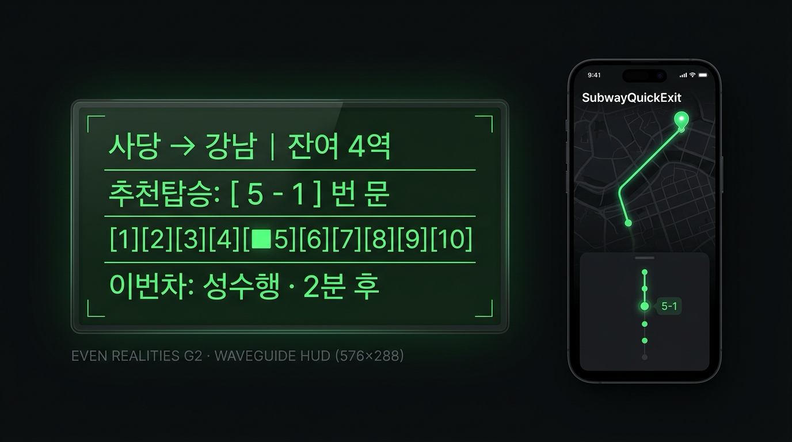

# SubwayQuickExit

**Even Realities G2** 스마트 글래스용 **수도권 지하철 빠른환승 · 출구 안내 내비게이션** (Even Hub 웹앱)입니다.

출발지와 목적지를 설정하면 최적 지하철 경로를 탐색하고, G2 안경의 `576×288` 그린 단색 Micro-LED HUD에 **추천 탑승/빠른하차 칸-문**, **열차 도식**, **실시간 열차 도착 정보**를 깜빡임 없이 표시합니다.



---

## 주요 기능

- **출발지 → 목적지 경로 내비게이션 (`subwayGraph.ts`)**
  - 수도권 주요 노선(2·3·4·5·7·9호선, 신분당선) 노선망 기반 최단 경로 및 환승 구간 탐색
  - 승차·이동·환승·도착 단계별 여정 및 목적 출구/환승통로에 맞춘 **추천 탑승/빠른하차 칸-문** 안내
  - 노선별 열차 편성(10량 / 8량 / 6량) 자동 반영 도식 (`[1][2][3][4][■5]...`)
- **장소 검색 + 지도 핀 선택 (`kakaoLocal.ts`, Leaflet)**
  - 카카오 로컬 키워드 검색 결과를 **Leaflet + OpenStreetMap** 지도에 번호 핀으로 표시
  - 지도 핀 클릭, 목록 선택, 또는 지도 임의 지점 탭으로 가장 가까운 지원 지하철역 자동 매칭
  - **현위치 출발** 및 **출퇴근 즐겨찾기 경로 저장 / 왕복 전환(`⇄`)**
- **GPS 자동 구간 전환 (`GPS 자동진행`)**
  - HTTPS(Even Hub) 환경에서 기본 활성화되며, 이동 중 다음 역 반경 450m 이내 진입 시 HUD를 자동으로 다음 역으로 전환
- **서울시 실시간 열차 도착 정보 (`subwayApi.ts`)**
  - 서울 열린데이터광장 `realtimeStationArrival` 연동 (20초 주기 폴링)
  - **`이번차:` / `다음차:` 2줄 포맷**으로 행선지, 급행 여부, 도착 시간, 현재 위치 표시
- **Cloudflare Workers API 프록시 (`proxy/cloudflare-worker.js`)**
  - `KAKAO_REST_API_KEY` 및 `SEOUL_API_KEY`를 서버 시크릿으로 숨기고 엣지 캐싱 및 HTTPS 래핑 제공

---

## G2 안경 HUD 레이아웃 & 제스처

`576×288` 논리 캔버스를 3개 `TextContainer`로 분할하고 `textContainerUpgrade`로 부분 갱신합니다.

| 영역 | 높이 | 내용 |
| :--- | :--- | :--- |
| 상단 상태 바 (`hud_top`) | `36px` | `[출발→도착] 잔여 N역 (약 N분) \| 실시간 도착` |
| 메인 HUD (`hud_main`) | `208px` | 현재 역 · 방면, 추천탑승/빠른하차 문, 열차 도식, 안내, 이번차/다음차 |
| 하단 가이드 (`hud_bot`) | `44px` | 제스처 안내 바 |

- **탭 (`CLICK_EVENT`) / 앞·위 스크롤 (`SCROLL_TOP_EVENT`):** 다음 정거장으로 이동
- **뒤·아래 스크롤 (`SCROLL_BOTTOM_EVENT`):** 이전 정거장으로 이동
- **더블탭 (`DOUBLE_CLICK_EVENT`):** 앱 종료

---

## 개발 및 배포

### 1. 로컬 실행 및 시뮬레이터 / QR 프리뷰
```bash
npm install
npm run dev
# 별도 터미널에서 시뮬레이터 또는 실기기 QR
npm run simulate
npx evenhub qr
```

### 2. Cloudflare Workers 프록시 설정 (선택)
```bash
# 로컬 테스트용 키 설정
cp .dev.vars.example .dev.vars
npm run proxy:dev

# Cloudflare 배포
npx wrangler login
npx wrangler secret put KAKAO_REST_API_KEY
npx wrangler secret put SEOUL_API_KEY
npm run proxy:deploy
```

### 3. `.ehpk` 패키징
```bash
npm run pack
```
생성된 `SubwayQuickExit.ehpk`를 [Even Hub 개발자 포털](https://hub.evenrealities.com)에 업로드합니다.

---

## 기술 스택
- TypeScript, Vite, `@evenrealities/even_hub_sdk`
- Leaflet (OpenStreetMap), Kakao Local API, 서울 열린데이터광장 실시간 도착 API
- Cloudflare Workers
